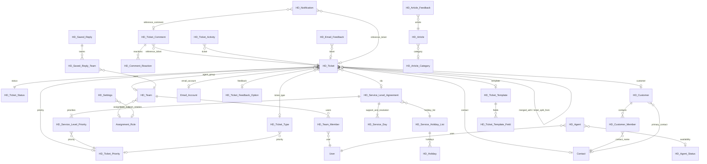

# Frappe Helpdesk — Developer Project Guide (WBH)

A reference for developers who extend, add features to, or fix bugs in this repository.

- **Snapshot:** branch `WBH-9-2026`, app version `1.30.1` (`helpdesk/__init__.py`), last commit `1c3361c` "chore(release): Bumped to Version 1.30.1" (2026-09-03). The history contains no WBH-specific commits yet, so this checkout matches upstream `frappe/helpdesk` at that release (checked with `git log`).
- **How to read the citations:** every claim names the file(s) behind it in backticks, with `:line` where useful. Line numbers are from the snapshot above and will drift.
- **"Unverified"** marks anything inferred from names, comments, or partial reads that was not confirmed by reading the code path end to end or by running it. Nothing in this guide was confirmed by running the app, because no bench or site exists in the environment where it was written.
- **Companion files:** `AGENTS.md` (the project's binding coding rules; this guide summarises them in §5 but does not replace them) and `CLAUDE.md` (a short command-and-convention cheat sheet).

## Contents

1. [Purpose and main features](#1-purpose-and-main-features)
2. [Tech stack, setup, and how to run it](#2-tech-stack-setup-and-how-to-run-it)
3. [Folder and module map](#3-folder-and-module-map)
4. [Architecture and data flow](#4-architecture-and-data-flow)
5. [Where to start, and the conventions to follow](#5-where-to-start-and-the-conventions-to-follow)
6. [Known issues, TODOs, and fragile areas](#6-known-issues-todos-and-fragile-areas)

---

## 1. Purpose and main features

**Purpose.** Frappe Helpdesk is an open-source (AGPLv3) ticket-management and customer-service application. It is a **Frappe app**: it cannot run alone and is installed into a Frappe "bench" site next to the `frappe` framework and the `telephony` app (`README.md`, `helpdesk/hooks.py:1-9`, `pyproject.toml` `[tool.bench.frappe-dependencies]`). The UI is a Vue single-page app served at `/helpdesk` (`helpdesk/hooks.py:49-54`, `pyproject.toml` `[tool.bench.assets]`).

**Main features** (each row names where it lives):

| Feature | What it does | Where it lives |
|---|---|---|
| Agent portal and customer portal | One SPA with two "roots": agents work tickets; customers (portal users with the `HD Customer`/`HD Customer Manager` roles) raise and follow their own tickets | `README.md` "Key Features"; roles set up in `helpdesk/setup/install.py:214-247`; frontend roots in `desk/src/roots/` |
| Tickets | The core record (`HD Ticket`), created from email, the portal, or the agent UI, with status, priority, type, team, assignment, and a timeline of emails, comments, and activities | `helpdesk/helpdesk/doctype/hd_ticket/`, `helpdesk/api/ticket.py` |
| Email-to-ticket and replies | Incoming mail on a support Email Account becomes a ticket or a reply; agents reply by email from the ticket | `helpdesk/overrides/email_account.py` (overrides the `Email Account` class via `helpdesk/hooks.py:123-127`), `helpdesk/api/settings/email.py`, `helpdesk/templates/emails/` |
| Configurable statuses | Custom ticket statuses grouped into categories (Open / Paused / Resolved); a separate customer-facing label is supported | `helpdesk/helpdesk/doctype/hd_ticket_status/`; defaults in `helpdesk/setup/install.py:386-424` |
| SLAs | Response and resolution targets per priority, working hours, and holiday lists; SLA status is refreshed hourly | `helpdesk/helpdesk/doctype/hd_service_level_agreement/`, `hd_service_level_priority/`, `hd_service_day/`, `hd_service_holiday_list/`, `hd_holiday/`; scheduler in `helpdesk/hooks.py:43-45`; default "Standard" SLA in `helpdesk/setup/install.py:64-134` |
| Assignment rules and teams | Auto-assign tickets through Frappe's `Assignment Rule` ("Round Robin" and "Load Balancing" rules get Helpdesk-specific handling in `helpdesk/overrides/assignment_rule.py:41`), per team or site-wide | `helpdesk/helpdesk/doctype/hd_team/`, `helpdesk/overrides/assignment_rule.py`, `helpdesk/extends/assignment_rule.py`, `helpdesk/api/assignment_rule.py` |
| Knowledge base | Articles in categories, article feedback, and article suggestions while a customer writes a ticket (`README.md` screenshots section) | `helpdesk/helpdesk/doctype/hd_article/`, `hd_article_category/`, `hd_article_feedback/`, `helpdesk/api/knowledge_base.py`, `helpdesk/api/article.py` |
| Search | Full-text search built on Frappe's SQLite search framework, plus stopwords and synonyms | `helpdesk/search_sqlite.py` (registered at `helpdesk/hooks.py:33`), `helpdesk/search.py`, `hd_stopword/`, `hd_synonym/`, `hd_synonyms/` |
| Saved replies | Reusable reply templates, optionally scoped to teams | `helpdesk/helpdesk/doctype/hd_saved_reply/`, `hd_saved_reply_team/`, `helpdesk/api/saved_replies.py` |
| Customer feedback | Ratings and feedback options after resolution, including an email feedback web form | `hd_ticket_feedback_option/`, `hd_email_feedback/`, `helpdesk/helpdesk/web_form/email_feedback/`, `helpdesk/setup/ticket_feedback.py` |
| Saved views | Per-user or public list views (columns, filters, sort) for tickets and other lists, with standard views shipped on install | `helpdesk/helpdesk/doctype/hd_view/`, `helpdesk/setup/default_views.py` |
| Ticket templates, field layout, form scripts | Admins choose which fields a ticket form shows (templates, layouts) and can attach client-side scripts to forms | `hd_ticket_template/`, `hd_ticket_template_field/`, `hd_field_layout/`, `hd_form_script/` |
| Customers and contacts | `HD Customer` organisations linked to Frappe `Contact` records; customer managers may also see their organisation's tickets (`_is_customer_manager` check in `helpdesk/helpdesk/doctype/hd_ticket/hd_ticket.py:1340`) | `helpdesk/helpdesk/doctype/hd_customer/`, `hd_customer_member/`, `helpdesk/api/customer.py`, `helpdesk/api/contact.py` |
| Agents and presence | Agent records, availability status (Active / Away / Unavailable), @-mentions, in-app notifications | `hd_agent/`, `hd_agent_status/`, `hd_notification/`, `helpdesk/mixins/mentions.py`, `helpdesk/api/agent.py` |
| Live collaboration | Who-is-viewing and who-is-typing indicators on a ticket, over Socket.IO | `realtime/handlers.js` |
| Dashboards and analytics | Agent home page, ticket statistics, and analytics charts; Frappe desk reports | `helpdesk/api/dashboard.py`, `helpdesk/api/ticket_analytics.py`, `helpdesk/api/ticket_stats.py`, `helpdesk/api/agent_home/`, `helpdesk/helpdesk/report/` |
| Onboarding and invitations | Setup checklist for new sites; invite agents or customers by email through Frappe's `User Invitation` | `helpdesk/api/onboarding.py`, `helpdesk/hooks.py:56-74`, `helpdesk/overrides/user_invitation.py`, `helpdesk/helpdesk/hooks/user_invitation.py` |
| ERPNext integration (optional) | Two-way sync of `HD Customer` ↔ ERPNext `Customer`, and mirroring of their `User Permission` and `DocShare` records, when ERPNext is installed and the integration is enabled | `helpdesk/integrations/erpnext/`, `helpdesk/helpdesk/doctype/erpnext_hd_settings/`, wired by `doc_events` in `helpdesk/hooks.py:76-103` |
| Automatic housekeeping | Daily auto-close of tickets after N days; search index build and NLP corpus download | `helpdesk/hooks.py:24-46` |
| Translations | About 30 locales, synced with Crowdin | `helpdesk/locale/*.po`, `crowdin.yml`, `.github/workflows/generate-pot-file.yml` |

## 2. Tech stack, setup, and how to run it

### 2.1 Tech stack

| Layer | Technology and version | Source |
|---|---|---|
| Backend language | Python ≥ 3.10 (CI uses 3.12) | `pyproject.toml` `requires-python`; `.github/workflows/server-tests.yml` |
| Backend framework | Frappe Framework `>=15.116.1,<17.0.0` (so v15 and v16) | `pyproject.toml` `[tool.bench.frappe-dependencies]`; `README.md` compatibility matrix |
| Required sibling app | `telephony` (`>=0.0.1,<1.0.0`) | `helpdesk/hooks.py:9`; `pyproject.toml` |
| Optional sibling app | ERPNext (turns on the customer-sync integration; CI installs it) | `helpdesk/integrations/erpnext/utils.py:222-225`; `.github/helpers/install.sh` |
| Python dependency | `textblob==0.18.0.post0`; NLTK corpora are downloaded at runtime | `pyproject.toml`; `helpdesk/search.py:377-387` |
| Database / cache / queue | MariaDB (CI 10.6, Docker 10.8), Redis | `.github/workflows/server-tests.yml`; `docker/docker-compose.yml` |
| Realtime | Frappe's Socket.IO server, plus Helpdesk handlers in `realtime/handlers.js`. That Frappe loads this file automatically by its path is **Unverified**. | `realtime/handlers.js` |
| Frontend | Vue `^3.5.14`, `frappe-ui` `1.0.0-beta.24` (patched with patch-package), Pinia `^2.0.33`, vue-router `^4.2.2`, `@vueuse/core` `^13.8.0`, Tiptap `^3.26.0`, `socket.io-client` `^4.7.2`, Tailwind `^3.4.15`, TypeScript `^5.0.2` | `desk/package.json`; `desk/patches/frappe-ui+1.0.0-beta.24.patch` |
| Frontend build | Vite `^4.4.9` with the frappe-ui Vite plugin (Frappe proxy, Lucide icons, Jinja boot data), `@framework/ui`, Vue JSX, and a PWA plugin; output goes to `helpdesk/public/desk`, and the HTML entry to `helpdesk/www/helpdesk/index.html` | `desk/vite.config.js:12-93`; `pyproject.toml` `[tool.bench.assets]` |
| Python packaging | `flit_core` | `pyproject.toml` `[build-system]` |

> **Setup gotcha: `@framework/ui`.** `desk/package.json:13` declares `"@framework/ui": "link:../../frappe/ui"`, and `desk/vite.config.js:1,45` imports and uses it. The frontend therefore expects `frappe-bench/apps/frappe/ui` to exist. Which Frappe versions ship that `ui/` folder is **Unverified**; if `yarn dev` or `yarn build` fails to resolve `@framework/ui`, check that path first.
>
> **The `frappe-ui` git submodule is not checked out** in this clone (`git submodule status` shows `-a3d141c…`). It is only needed if you want to develop against a local frappe-ui: `desk/vite-helpers.ts:29-41` switches to `../frappe-ui` in development mode only when `frappe-ui/node_modules` exists.

### 2.2 Setup options

**A. Local bench (recommended for WBH work).** These steps come from `README.md` "Local". Replace the upstream URL with your fork's URL or a local path so that you run *this* code:

```bash
# 1. Install bench and create a bench (Frappe docs: frappeframework.com/docs/user/en/installation)
bench init frappe-bench --frappe-branch version-15   # or a v16 branch; see pyproject.toml
cd frappe-bench
bench new-site helpdesk.test
bench --site helpdesk.test add-to-hosts
bench get-app https://github.com/frappe/telephony      # required app (helpdesk/hooks.py:9)
bench get-app <your-fork-url-or-local-path-to-this-repo>
bench --site helpdesk.test install-app helpdesk          # runs helpdesk.setup.install.after_install
bench build --app helpdesk
bench start                                              # web on :8000, plus workers, scheduler, socketio
# Open http://helpdesk.test:8000/helpdesk
```

`install-app` runs `after_install` (`helpdesk/hooks.py:24`, `helpdesk/setup/install.py:17-39`). It creates the custom fields, the default statuses (Open, Replied, Resolved, Closed), the agent statuses, the default article category and article, the priorities (Urgent, High, Medium, Low), a "Standard" SLA with Mon–Fri 10:00–18:00 hours and a "Default" holiday list, the teams "Billing" and "Product Experts", role permissions, the customer roles, a default assignment rule, the default ticket template and ticket types, the standard views, a welcome ticket, and the full-text indexes on `HD Ticket.subject` and `HD Ticket.description`.

**B. Frontend hot reload.** From `README.md` "For Frontend Development":

```bash
cd frappe-bench/apps/helpdesk/desk
yarn install        # its postinstall runs patch-package (desk/package.json scripts)
yarn dev            # Vite dev server; README says it is reachable at http://helpdesk.test:8080
```

The frappe-ui plugin runs with `frappeProxy: true` (`desk/vite.config.js:22`), which proxies API calls to the bench web server. That the proxy targets port 8000 by default is **Unverified** (it is the frappe-ui plugin's behaviour, not code in this repo). The root `package.json` only forwards to `desk/`: `yarn dev` and `yarn build` there run `cd desk && yarn dev` and `cd desk && yarn build`.

**C. Docker.** `docker/docker-compose.yml` starts MariaDB, Redis, and a `frappe/bench` container that runs `docker/init.sh`. That script creates the site `helpdesk.localhost` (admin password `admin`), installs telephony and helpdesk, and turns on `developer_mode`, `mute_emails`, and `server_script_enabled` (`docker/init.sh:28-38`). **Caveat for WBH:** `docker/init.sh:26` runs `bench get-app helpdesk --branch main`, which fetches the app from upstream rather than from your checkout. The compose file mounts your folder at `/workspace` (`docker/docker-compose.yml:25`), but `init.sh` never installs from it. That `bench get-app helpdesk` resolves to `github.com/frappe/helpdesk` is **Unverified**, but nothing in the script points it at `/workspace`.

**D. Production.** Use Frappe Cloud or the `easy-install.py` flow with the `ghcr.io/frappe/helpdesk` image (`README.md` "Production Setup"). The image is built by `.github/workflows/build.yml` from `frappe_docker` with Frappe `version-15`, telephony `develop`, and helpdesk `main`.

### 2.3 Day-to-day commands

| Task | Command | Source |
|---|---|---|
| Run the whole backend test suite | `bench --site <site> run-tests --app helpdesk` | `.github/workflows/server-tests.yml` ("Run Tests") |
| Run one test module | `bench --site <site> run-tests --module helpdesk.helpdesk.doctype.hd_ticket.test_hd_ticket` | Standard Frappe CLI; **Unverified** in this repo |
| Test-site prerequisites | CI installs **erpnext, telephony, and helpdesk** into the test site. `before_tests` resets HD Settings, creates an SLA, holiday list, email account, and the ERPNext `hd_customer` field, and runs the ERPNext setup wizard if ERPNext is present | `.github/helpers/install.sh`; `helpdesk/hooks.py:143`; `helpdesk/test_utils.py:22-35,594-606` |
| Enable tests on a site | If `run-tests` refuses to run, `bench --site <site> set-config allow_tests true` (standard Frappe behaviour; **Unverified** for your Frappe version) | — |
| Build the frontend | `cd desk && yarn build` (or `bench build --app helpdesk`) | `desk/package.json`; `README.md` |
| Python lint/format | `pre-commit run --all-files` runs black 22.6.0, flake8 5.0.4 (with `.github/helpers/.flake8_strict` and bugbear, comprehensions, and simplify plugins), isort (black profile), and prettier 2.6.2 for JS, Vue, and HTML | `.pre-commit-config.yaml` |
| Extra CI lint | Frappe semgrep rules plus `r/python.lang.correctness`, and commitlint on PR commit titles | `.github/workflows/lint.yml` |
| Frontend lint | Root `.eslintrc.js` (vue3-recommended, TypeScript, Tailwind, Prettier) with `.lintstagedrc` running `eslint --fix`. Neither `package.json` declares ESLint or lint-staged as a dependency, so how these are installed is **Unverified**. | `.eslintrc.js`; `.lintstagedrc`; `package.json`; `desk/package.json` |
| Frontend tests | None configured: `desk/package.json` has no test script and no test runner dependency | `desk/package.json` |
| Debug script | Write `helpdesk/debug.py` with `def execute():`, then run `bench --site <site> execute helpdesk.debug.execute` | `AGENTS.md` "Debugging Workflow" |
| Translations | `bench generate-pot-file --app helpdesk` regenerates `helpdesk/locale/main.pot` (CI does this weekly) | `.github/helpers/update_pot_file.sh`; `.github/workflows/generate-pot-file.yml` |

### 2.4 Branching, CI, and release (upstream conventions)

- **Branches.** Upstream develops on `develop` and ships from `main` (stable, where Mergify auto-closes outside PRs) and `main-hotfix`. Backports are applied through labels (`.mergify.yml`). WBH work in this fork happens on feature branches such as `WBH-9-2026`.
- **Commits.** Use Conventional Commits with the types `build`, `chore`, `ci`, `docs`, `feat`, `fix`, `perf`, `refactor`, `revert`, `style`, `test` (`commitlint.config.mjs`). CI enforces this on PRs to `main`, `main-hotfix`, and `develop` (`.github/workflows/lint.yml`).
- **CI on PRs.** Server tests run on MariaDB 10.6 with Frappe `version-15` and ERPNext `version-15` (`.github/workflows/server-tests.yml`, `.github/helpers/install.sh`). Changes that touch only `.js`, `.css`, `.md`, `.html`, or `.csv` files skip the server tests (`paths-ignore` in `server-tests.yml`). `.vue` and `.ts` files are **not** in that list, so frontend-only changes still trigger them.
- **Release.** semantic-release runs on `main` and rewrites the version in `helpdesk/__init__.py` (`.releaserc`, `.github/workflows/on_release.yml`). A container image is built on pushes to `main` and on tags (`.github/workflows/build.yml`).

## 3. Folder and module map

### 3.1 Repository root

| Path | What it is | Source |
|---|---|---|
| `helpdesk/` | The Python package, which is the Frappe app itself (see §3.2) | `pyproject.toml` `[project] name` |
| `desk/` | The Vue 3 SPA source (see §3.3). It is built into `helpdesk/public/desk/` | `pyproject.toml` `[tool.bench.assets]`; `desk/vite.config.js:26-28` |
| `realtime/handlers.js` | Extra Socket.IO handlers: `view_ticket`, `stop_view_ticket`, `ticket_get_viewers`, `notify_ticket_update`, `helpdesk_ticket_typing`, `helpdesk_ticket_typing_stopped`, which emit `ticket_viewers`, `ticket_update`, and the typing events to the `open_doc:HD Ticket/<id>` room | `realtime/handlers.js:1-112` |
| `frappe-ui/` | Git submodule of frappe-ui, used only when developing against a local frappe-ui. Not checked out here | `.gitmodules`; `desk/vite-helpers.ts:29-41` |
| `docker/` | Docker dev environment (§2.2 C) | `docker/docker-compose.yml`, `docker/init.sh` |
| `.github/` | CI workflows, the CI bench installer, the strict flake8 config, and issue templates | `.github/workflows/*.yml`, `.github/helpers/` |
| `AGENTS.md` | The project's coding rules for humans and AI agents (§5.3) | `AGENTS.md` |
| `package.json` (root) | Thin wrapper whose scripts forward to `desk/`, plus dependency `resolutions` | `package.json` |
| Lint and format config | `.pre-commit-config.yaml`, `.flake8`, `.eslintrc.js`, `.prettierrc.json`, `.lintstagedrc`, `commitlint.config.mjs` | those files |
| Release and ops config | `.releaserc` (semantic-release), `.mergify.yml` (backports, auto-close on `main`), `crowdin.yml` (translations) | those files |

### 3.2 Backend: `helpdesk/` (the Frappe app)

| Path | What it does | Source |
|---|---|---|
| `hooks.py` | **The wiring diagram of the app.** It declares the required app, the apps-screen entry, `after_install`/`after_migrate`, the SQLite search class, scheduler jobs, the `/helpdesk/<path>` → SPA route, User Invitation rules, `doc_events` for the Assignment Rule, Customer, User Permission, DocShare, and Notification Log doctypes, `permission_query_conditions` and `has_permission` for HD Ticket, HD Saved Reply, HD Customer, and HD Agent, the three `override_doctype_class` entries, `before_tests`, and `auth_hooks`. Read this first when tracing any behaviour that "just happens". | `helpdesk/hooks.py:1-144` |
| `helpdesk/helpdesk/doctype/` | **36 DocTypes**, the data model (§4.2). Each folder has `<name>.json` (schema), `<name>.py` (controller), and often `<name>.js` (Desk form script) and `test_<name>.py`. Some folders also hold `api.py` modules and `patches/` | `helpdesk/helpdesk/doctype/*/` |
| `helpdesk/helpdesk/doctype/hd_ticket/api.py` | **Core ticket endpoints live here, not in `helpdesk/api/`**: `new` (portal ticket creation), `get_one`, `merge_ticket`, `split_ticket`, `get_ticket_activities`, and more | `helpdesk/helpdesk/doctype/hd_ticket/api.py:29,39,327,445,738` |
| `helpdesk/helpdesk/report/` | Five Frappe Desk script reports: first response time, support hour distribution, ticket analytics, ticket search analysis, ticket summary | `helpdesk/helpdesk/report/*/` |
| `helpdesk/helpdesk/web_form/` | Frappe web forms `tickets` and `email_feedback` | `helpdesk/helpdesk/web_form/*/` |
| `helpdesk/helpdesk/workspace/helpdesk/` | Desk workspace definition for the classic `/app` UI | `helpdesk/helpdesk/workspace/helpdesk/` |
| `helpdesk/helpdesk/hooks/user_invitation.py` | `after_accept` handler for User Invitation (links the new user to Contact and HD Customer) | wired at `helpdesk/hooks.py:72` |
| `helpdesk/helpdesk/utils/email.py` | Email helpers used by ticket code | `helpdesk/helpdesk/utils/email.py` |
| `api/` | Whitelisted HTTP endpoints for the SPA, one module per concern (full map in §4.4) | `helpdesk/api/*.py` |
| `api/agent_home/` | Widgets for the agent "Home" dashboard | `helpdesk/api/agent_home/agent_home.py` |
| `api/settings/` | Settings-modal backends: email account creation, email notification templates, field dependencies | `helpdesk/api/settings/*.py` |
| `utils.py` | Shared helpers. Permission helpers (`is_admin` L35, `is_agent` L46, `get_agent_name` L62, `agent_only` L179, `is_agent_manager` L196, `agent_manager_only` L207, `get_agents_team` L224), `publish_event` L76 (realtime to the website room, after commit), `get_doc_room` L96, `get_customers` L104, and list-view presets | `helpdesk/utils.py` |
| `auth.py` | Optional endpoint allowlist for non-System users (`auth_hooks`). It only runs when site config sets `block_endpoints` | `helpdesk/auth.py:66-101`; `helpdesk/hooks.py:144` |
| `search.py` | **Knowledge-base** search on Redisearch (`HelpdeskSearch` L214, `build_index` L357, `download_corpus` L377) | `helpdesk/search.py` |
| `search_sqlite.py` | **Ticket, comment, and email** full-text search on Frappe's `SQLiteSearch` (`HelpdeskSearch` L18). Two different classes share the name `HelpdeskSearch` | `helpdesk/search_sqlite.py`; `helpdesk/hooks.py:33` |
| `overrides/` | **Class overrides** of core doctypes through `override_doctype_class`: `CustomEmailAccount` (inbound mail → ticket threading), `HelpdeskAssignmentRule` (prefers Active, then Away agents), `HelpdeskUserInvitation` (branded email title) | `helpdesk/overrides/*.py`; `helpdesk/hooks.py:123-127` |
| `extends/` | **Function hooks** on core doctypes through `doc_events`: Assignment Rule validate/trash, and Notification Log link rewriting. `data_import.bulk_insert` is whitelisted but has no caller in the repo | `helpdesk/extends/*.py`; `helpdesk/hooks.py:76-103` |
| `mixins/mentions.py` | `HasMentions` mixin that turns `@mentions` into `HD Notification` rows. It is used only by `HDTicketComment` | `helpdesk/mixins/mentions.py:7`; `helpdesk/helpdesk/doctype/hd_ticket_comment/hd_ticket_comment.py:14-15` |
| `integrations/erpnext/` | Optional ERPNext sync: `api.py` (sync status and bulk sync job), `customer.py` (Customer `doc_events`), `user_permission.py` and `doc_share.py` (mirror records through the generic `mirror_sync.py`), `utils.py` (link fields, rename cascade, field sync), and tests | `helpdesk/integrations/erpnext/*.py` |
| `setup/` | Install-time seeding (`install.py`), the setup-wizard hook that creates the first HD Agent (`setup_wizard.py`), default views, ticket types, feedback options, template, file folder, and welcome ticket | `helpdesk/setup/*.py`; `helpdesk/hooks.py:24,137` |
| `patches/` + `patches.txt` | Migration patches run by `bench migrate`, split into `[pre_model_sync]` and `[post_model_sync]`. A few live under doctype folders (for example `hd_ticket/patches/`) | `helpdesk/patches.txt` |
| `templates/emails/` | Jinja email templates (agent reply, portal reply notification, email verification, generic notification) | `helpdesk/templates/emails/*.html` |
| `www/helpdesk/index.py` | Serves the SPA shell. `get_context` injects `boot` (CSRF token, session user, agent name, formats, timezones, installed apps, telemetry config). `get_context_for_dev` returns the same boot for the Vite dev server, in developer mode only | `helpdesk/www/helpdesk/index.py:13-58` |
| `public/` | Built SPA assets (`public/desk/`, gitignored) and `public/erpnext/customer_list.js`, a Desk list script for ERPNext Customer that nothing in the repo appears to load (§6) | `.gitignore`; `helpdesk/public/erpnext/customer_list.js` |
| `locale/` | `main.pot` and about 30 `.po` translation files | `helpdesk/locale/` |
| `config/` | Legacy Desk module config (`desktop.py`, `docs.py`) | `helpdesk/config/*.py` |
| `consts.py` | Default names: ticket type `Unspecified`, priority `Medium`, template `Default`, SLA `Standard`, article category `General` | `helpdesk/consts.py` |
| `activation.py` | `get_site_info` hook that reports doctype counts | `helpdesk/activation.py`; `helpdesk/hooks.py:22` |
| `test_utils.py` | **The shared test-helper module** (factories, toggles, `before_tests`). AGENTS.md rule 3 requires every backend test helper to live here | `helpdesk/test_utils.py`; `AGENTS.md` "Test Utilities" |

### 3.3 Frontend: `desk/`

| Path | What it does | Source |
|---|---|---|
| `package.json`, `yarn.lock` | Scripts `dev`, `build`, `serve`, and `postinstall` (patch-package). There is **no** lint, typecheck, or test script | `desk/package.json:6-11` |
| `vite.config.js`, `vite-helpers.ts` | Vite config (§2.1). The frappe-ui plugin provides the dev proxy to the bench, Lucide auto-import, Jinja boot injection, the build output path, and doctype type generation into `src/types/doctypes.ts` for the doctypes listed in `frappeTypes` | `desk/vite.config.js:19-44` |
| `patches/` | patch-package patch for `frappe-ui@1.0.0-beta.24`. It touches `MultiSelect` (suffix slot), the suggestion extension (`allowSpaces`), the link mark (non-inclusive), and the suggestion renderer. **When you bump frappe-ui, re-create or drop this patch** | `desk/patches/frappe-ui+1.0.0-beta.24.patch` |
| `tsconfig.json` | Extends `frappe-ui/tsconfig.base.json` and adds strict-style flags (`noUncheckedIndexedAccess`, `exactOptionalPropertyTypes`, …). It also maps `@framework/ui` to `../../frappe/ui/src` | `desk/tsconfig.json` |
| `tailwind.config.js`, `postcss.config.js`, `src/index.css` | Tailwind with the `frappe-ui/tailwind` preset, typography, RTL, and a `hide-scrollbar` utility | `desk/tailwind.config.js` |
| `index.html` | Jinja-flavoured HTML shell (`lang`/`dir` from `boot`; mount points `#app`, `#modals`, `#popovers`). The build copies it to `helpdesk/www/helpdesk/index.html` | `desk/index.html`; `desk/vite.config.js:28` |
| `src/main.js` | App bootstrap (§4.7) | `desk/src/main.js` |
| `src/App.vue` | Root component: `FrappeUIProvider`, dialogs, favicon, theme, online/offline toasts | `desk/src/App.vue` |
| `src/router/index.ts` | All routes and the global guards (§4.7) | `desk/src/router/index.ts` |
| `src/roots/` | `PortalRoot.vue` picks `AgentRoot` or `CustomerPortalRoot` **from the session** (desk access and agent flags), not from the URL. Each root then picks a mobile or desktop layout | `desk/src/roots/PortalRoot.vue:17-24` |
| `src/pages/` | Route-level screens. Agent side: `home/`, `ticket/` (`Tickets.vue`, `TicketAgent.vue`, `MobileTicketAgent.vue`, `TicketNew.vue`), `dashboard/`, `SearchAgent.vue`, `knowledge-base/`, `customer/`, `contact/`, `call-logs/`, `MobileNotifications.vue`. Customer side: `ticket/TicketCustomer.vue`, `knowledge-base/KnowledgeBaseCustomer.vue`, `Articles.vue`. Shared: `Tickets.vue`, `TicketNew.vue`, and `Article.vue`, which branch on `isCustomerPortal`. Also `PersonaForm.vue` (onboarding) and `InvalidPage.vue` | `desk/src/pages/**` |
| `src/stores/` | Pinia stores: `auth`, `config`, `user`, `agent`, `agentStatus`, `notification`, `sidebar`, `telephony` (options-style), `ticketPriority`, `ticketStatus`, `globalStore`. Also some **non-Pinia** modules with module-level state: `meta.ts`, `docTickets.ts`, `knowledgeBase.ts`, `sla.ts`, `holidayList.ts`, `assignmentRules.ts` | `desk/src/stores/*.ts` |
| `src/composables/` | Reusable logic, for example `useTicket.ts` (per-ticket resource cache), `useView.ts` (HD View CRUD), `realtime.ts` (viewers and typing), `formCustomisation.ts` (runs HD Form Scripts), `shortcuts.ts`, `useSLA.ts`, `contact.ts`, `customer.ts`, `useTags.ts`, `screen.ts` | `desk/src/composables/*.ts` |
| `src/components/` | About 350 reusable and feature components (§3.4) | `desk/src/components/` |
| `src/socket.ts` | Socket.IO client. It reads `socketio_port` from the bench's `sites/common_site_config.json` **at build time**, so builds must run inside a bench | `desk/src/socket.ts:2,11-21` |
| `src/translation.ts` | `__()` for templates and `window`. It fetches `helpdesk.api.general.get_translations` when the boot has no messages | `desk/src/translation.ts` |
| `src/telemetry.ts`, `src/persona.ts` | Telemetry wrapper; onboarding persona interrupt | those files |
| `src/utils.ts`, `src/types.ts`, `src/types/doctypes.ts` | Shared helpers (date formatting, `isCustomerPortal` global ref at `utils.ts:270`, …); hand-written types and injection keys; generated doctype types | those files |
| `src/tiptap-extensions.ts` | Custom Tiptap extensions for the editors (for example the field-autocomplete suggestion) | `desk/src/tiptap-extensions.ts` |
| `src/assets/` | Images, icons, fonts. The SVG sets under `assets/icons/` and `assets/custom_icons/` show no path references in `desk/src` (§6) | `desk/src/assets/` |
| `public/` | Static files served under `/assets/helpdesk/desk/`: favicon, PWA manifest icons, onboarding images and videos used by the welcome ticket | `desk/public/`; `helpdesk/setup/welcome_ticket.py` |
| `auto-imports.d.ts` (committed), `components.d.ts` (gitignored) | Generated by unplugin. `components.d.ts` is regenerated by the dev server and is **not** in the repo, even though AGENTS.md points to it | `.gitignore`; `AGENTS.md` |

### 3.4 Frontend components: `desk/src/components/`

_Filled in from the components research (next edit)._

## 4. Architecture and data flow

### 4.1 The big picture

```
 Browser ──GET /helpdesk/<path>──▶ website_route_rules (hooks.py:49-54)
    │                               └─▶ www/helpdesk/index.py:get_context → HTML shell + `boot` JSON
    │
    │  Vue SPA (desk/, built into helpdesk/public/desk)
    │   ├─ frappe-ui resources ──POST /api/method/helpdesk.api.* ──▶ @frappe.whitelist endpoints (helpdesk/api/, doctype api.py)
    │   │                        └─ /api/method/frappe.client.* ──▶ generic Frappe CRUD (permission hooks still apply)
    │   └─ socket.io-client ◀──── realtime events (publish_event / publish_realtime, after commit)
    │                       ────▶ realtime/handlers.js (viewers, typing)
    ▼
 DocType controllers (helpdesk/helpdesk/doctype/*) ──▶ MariaDB
    ▲            ▲
    │            └─ doc_events / override_doctype_class on core doctypes (hooks.py:76-127)
    │
 Background: scheduler (hooks.py:35-46) · RQ workers (frappe.enqueue) · Email Account pull
             (overrides/email_account.py) → Communication → HD Ticket.on_communication_update
```

Sources: `helpdesk/hooks.py`, `helpdesk/www/helpdesk/index.py`, `helpdesk/utils.py:76-93` (`publish_event`), `realtime/handlers.js`, `helpdesk/overrides/email_account.py`, `helpdesk/helpdesk/doctype/hd_ticket/hd_ticket.py:1072`.

**Key architectural facts**

- **No separate portal backend.** Agents and customers call the same endpoints. Agent-only endpoints carry `@agent_only` or `@agent_manager_only` (`helpdesk/utils.py:179,207`). Row-level ticket security comes from the `has_permission` and `permission_query_conditions` hooks (`helpdesk/hooks.py:106-117`). Those hooks apply to `frappe.get_list`, `frappe.get_doc`, and `has_permission` calls, and **not** to raw `frappe.qb` or `frappe.get_all` queries (§4.4).
- **Business logic lives in DocType controllers.** The API layer is mostly thin. The exceptions are the analytics endpoints (`helpdesk/api/dashboard.py`, `helpdesk/api/agent_home/`), which run their own `frappe.qb` queries.
- **Much behaviour hangs off Frappe's own machinery.** Examples: email threading (`Email Account` override), auto-assignment (Frappe `Assignment Rule` plus the `HelpdeskAssignmentRule` override), notifications (`Notification Log` hook), and ToDo-based assignment (`frappe.desk.form.assign_to`). When debugging, you often need to read the Frappe source as well.

### 4.2 Data model

The model has 36 DocTypes (`helpdesk/helpdesk/doctype/*/`). None is submittable. The flags below were extracted from each DocType's `.json` file.

| Group | DocTypes (T = child table, S = Single) | Notes |
|---|---|---|
| **Tickets** | `HD Ticket`, `HD Ticket Comment`, `HD Comment Reaction` (T), `HD Ticket Activity`, `HD Notification`, `HD Email Feedback` | Tickets are named `.####`, an incrementing number (`hd_ticket/hd_ticket.json:5`). A comment is an *internal* agent note; customer-visible messages are Frappe `Communication` rows. `HD Ticket Activity` is the audit trail (`log_ticket_activity`, `hd_ticket_activity/hd_ticket_activity.py:12`) |
| **Ticket vocabularies** | `HD Ticket Status`, `HD Ticket Priority`, `HD Ticket Type`, `HD Ticket Feedback Option` | Each status has a **category**: Open, Paused, or Resolved. The code keys off `status_category`, not the status name (`hd_ticket.json:446` `fetch_from: status.category`) |
| **SLA** | `HD Service Level Agreement`, `HD Service Level Priority` (T), `HD Service Day` (T), `HD Service Holiday List`, `HD Holiday` (T) | §4.3.3 |
| **People and organisations** | `HD Agent`, `HD Agent Status`, `HD Team`, `HD Team Member` (T), `HD Customer`, `HD Customer Member` (T) | An `HD Agent` is named after its `User` (`hd_agent/hd_agent.py:41-45`). An `HD Customer` groups Frappe `Contact`s, and `HD Customer Member.is_manager` marks customer managers |
| **Knowledge base** | `HD Article`, `HD Article Category`, `HD Article Feedback` | The `General` category is reserved (`hd_article_category/hd_article_category.py:14-57`) |
| **Agent productivity** | `HD Saved Reply`, `HD Saved Reply Team` (T) | Scopes are Global, Team, or Personal. An `actions` JSON field can set status, priority, team, or type; assign; add or remove tags; or comment (`hd_saved_reply/hd_saved_reply.py:17-46`) |
| **UI configuration** | `HD View`, `HD Field Layout`, `HD Form Script`, `HD Ticket Template`, `HD Ticket Template Field` (T) | `HD Ticket Template` is marked "will be deprecated in the future" in its JSON (`hd_ticket_template/hd_ticket_template.json:7`) |
| **Search tuning** | `HD Stopword`, `HD Synonyms`, `HD Synonym` (T) | Used by the KB search in `helpdesk/search.py` |
| **Settings** | `HD Settings` (S), `ERPNext HD Settings` (S) | HD Settings is the main switchboard. Which code reads which field is in §4.3.6 |

**Relationships.** The diagram below shows only Link and Table fields confirmed in the DocType JSON files. Entity names use `_` in place of spaces.



**Relations that live in code, not in the schema** (they are easy to miss):

- **Communication ↔ HD Ticket** through `reference_doctype = "HD Ticket"` and `reference_name`. Communications are created in `reply_via_agent` and `create_communication_via_contact`, and handled in `on_communication_update` (`hd_ticket/hd_ticket.py:682-817, 819-864, 1072-1113`). HD Ticket's JSON also sets `email_append_to`, `sender_field: raised_by`, and `recipient_account_field: email_account`, so Frappe's email pipeline appends incoming mail to tickets (`hd_ticket/hd_ticket.json`).
- **Assignment** uses Frappe `ToDo` rows and the `_assign` JSON column, managed through `frappe.desk.form.assign_to` (`hd_ticket/hd_ticket.py:9-11, 520-561`).
- **Attachments** are `File` rows with `attached_to_doctype` and `attached_to_name` (`hd_ticket/hd_ticket.py:1115-1129`).
- **Tags** use Frappe `Tag` and `Tag Link`, plus the custom fields `Tag.app` and `Tag.color` added on install (`helpdesk/setup/install.py:280-295`; `helpdesk/api/tags.py`).
- **Calls** come from the telephony app's `TP Call Log`, through Dynamic Link (`hd_ticket/api.py:83-111`).
- **ERPNext Customer ↔ HD Customer** through the Data fields `Customer.hd_customer` and `HD Customer.erpnext_customer` (`helpdesk/integrations/erpnext/utils.py:228-264`).
- **User Invitation** gets the custom fields `contact` and `customer` (`helpdesk/setup/install.py:314-331`), consumed by `helpdesk/helpdesk/hooks/user_invitation.py`.

### 4.3 Ticket lifecycle (the core flow)

#### 4.3.1 Ways a ticket is created

| Path | Entry point | Source |
|---|---|---|
| Customer portal | `helpdesk.helpdesk.doctype.hd_ticket.api.new` sets `via_customer_portal` and inserts the ticket | `hd_ticket/api.py:29` |
| Incoming email | Frappe pulls mail through the `CustomEmailAccount` override, creates a `Communication`, and appends it to a new or existing `HD Ticket` (because of `email_append_to`). `CustomInboundMail.parent_communication` also threads replies through the `References` header, and mail with an `X-Auto-Generated` header is skipped | `helpdesk/overrides/email_account.py:35-99`; `hd_ticket.json` |
| Agent UI or Desk | Plain insert through `frappe.client` or Desk | — |
| Split or merge | `split_ticket`, `merge_ticket` (agents only) | `hd_ticket/api.py:327,445` |

#### 4.3.2 Controller hook order in `HD Ticket` (`helpdesk/helpdesk/doctype/hd_ticket/hd_ticket.py`)

Frappe runs the hooks in the order below. That this is Frappe's standard order is framework behaviour and was not re-checked here.

1. **`before_insert`** (`:71`): generates a UUID `key`, used by the email-feedback link.
2. **`before_validate`** (`:74-87`) runs these steps in order:
   - `check_update_perms`: blocks non-agents from editing a closed or already-rated ticket.
   - `set_ticket_type`, then `set_raised_by`.
   - `set_priority`: from the ticket type, else the default priority.
   - `set_first_responded_on`, `set_feedback_values`.
   - `set_default_status`: on new tickets, the SLA's or HD Settings' default status.
   - `set_status_category`.
   - `set_sla`: re-selected **on every save**.
   - `validate_portal_contact`, `set_contact`.
   - `set_customer`: gated by `auto_set_customer_from_contact`.
3. **`validate`** (`:89`): mandatory feedback when a customer resolves a ticket.
4. **`before_save`** (`:92-102`):
   - `set_resolution_date`.
   - `apply_sla`: calls `HDServiceLevelAgreement.apply`.
   - `handle_ticket_activity_update`: writes `HD Ticket Activity` rows for status, priority, team, contact, type, and SLA changes.
   - `handle_email_feedback`: sends the feedback email when the status becomes `send_email_feedback_on_status`.
   - Flags tickets raised outside working hours.
5. **`after_insert`** (`:170-189`):
   - Telemetry, then `publish_event("helpdesk:new-ticket")`.
   - Tags the customer's first ticket.
   - `create_communication_via_contact(description, new_ticket=True)`, so the description becomes the first Communication.
   - The acknowledgement email, if enabled and the ticket did not come from the portal.
6. **`on_update`** (`:225-241`):
   - Notifies assignees when a ticket re-opens.
   - `remove_assignment_if_not_in_team`.
   - `publish_update()`, which sends `helpdesk:ticket-update` to the `open_doc:HD Ticket/<id>` room.
7. **`on_trash`** (`:563`): hard-deletes the ticket's comments and activities.

#### 4.3.3 SLA engine (`helpdesk/helpdesk/doctype/hd_service_level_agreement/`)

- **Selection** is `get_sla()` in `hd_service_level_agreement/utils.py:12-50`:
  - Only enabled SLAs inside their date window count, and only if they define the ticket's priority.
  - Non-default SLAs are tried first, ordered by `rank` and then by creation. Each one's `condition` (a Python expression) is evaluated with `frappe.safe_eval` against the ticket.
  - The **default SLA matches without evaluating its condition**.
  - `condition_json` is only the UI's representation of the condition (`desk/src/components/Settings/Sla/SlaPolicyView.vue:444-484`).
- **Application** is `apply()` at `hd_service_level_agreement.py:189-194`:
  - Starts the clock, then sets first-response, resolution, and hold times on status transitions. Entering a **Paused**-category status starts hold time (`set_hold_time`, `:242`).
  - Computes `response_by` and `resolution_by` with `calc_time` (`:318-389`). It walks forward day by day and counts only the `HD Service Day` working windows that are not holidays.
  - Sets `agreement_status` (`handle_agreement_status`, `:292`), in the precedence Failed > Paused > First Response Due > Resolution Due > Fulfilled.
- **Refresh.** The hourly `update_sla_status_in_ticket` job re-runs `handle_agreement_status` for every Open ticket that has an SLA (`hd_ticket.py:1534-1562`; `helpdesk/hooks.py:43-45`). Saving a holiday list re-saves every Open ticket on each linked SLA (`hd_service_holiday_list/hd_service_holiday_list.py:83-104`).

#### 4.3.4 Assignment

- **Team rules.** Creating an `HD Team` creates a Frappe `Assignment Rule` named `"<team> - Support Rotation"`. Its assign condition is `status == 'Open' and agent_group == '<team>'` and its unassign condition is `agent_group != '<team>'`. The rule's user list is kept in sync with the team members (`hd_team/hd_team.py:23-116`).
- **Site-wide rule.** A disabled "Support Rotation" rule is created on install (`hd_settings/hd_settings.py:53`; `helpdesk/setup/install.py:259-261`).
- **Picking an agent.** Frappe's rule engine does the assigning. `HelpdeskAssignmentRule.get_user` narrows the candidate pool to agents whose `HD Agent Status` category is Active, then Away, then everyone (`helpdesk/overrides/assignment_rule.py:5-64`). "Based on Field" rules are left untouched.
- **Guards.** `extends/assignment_rule.py` blocks deleting the last HD Ticket rule, and only *warns* about users who are not in the linked team (`helpdesk/extends/assignment_rule.py:7-37`).
- **Manual assignment** goes through the whitelisted `HDTicket.assign_agent` (`hd_ticket.py:520`). A team change drops assignees who are not in the new team (`remove_assignment_if_not_in_team`, `:465`).

#### 4.3.5 Conversations and status transitions

- **Agent reply.** `HDTicket.reply_via_agent` (`hd_ticket.py:682-817`) is whitelisted and agent-only.
  - It picks the sender account in this order: the ticket's last communication, then the default *incoming* account with an `HD Ticket` IMAP folder, then the default outgoing account (`helpdesk/helpdesk/utils/email.py:84-111`).
  - It threads the mail with `message_id` and `In-Reply-To`, and sends it immediately or queued, depending on `instantly_send_email`.
  - When `skip_email_workflow` is set, it stores the reply without sending mail.
- **Customer reply from the portal.** `create_communication_via_contact` (`hd_ticket.py:819-864`) always sets the status to the *reopen status*, notifies assigned agents if enabled, and inserts a "Received" Communication.
- **Any Communication update.** Frappe calls `HDTicket.on_communication_update` (`hd_ticket.py:1072-1113`):
  - A received message stamps `last_customer_response` and moves the ticket to the reopen or default open status. On merged tickets, it is redirected to the end of the merge chain first (`get_merge_target`, `:1036`).
  - A sent message stamps `first_responded_on` and `last_agent_response`. It optionally applies `auto_update_status` → `update_status_to`.
- **Internal notes.** These are `HD Ticket Comment` rows, created with `HDTicket.new_comment` (`hd_ticket.py:665`). `@mentions` become `HD Notification` rows (`helpdesk/mixins/mentions.py`), and emoji reactions are handled by `toggle_reaction` (`hd_ticket_comment/hd_ticket_comment.py`).
- **Feedback.** Moving a ticket to `send_email_feedback_on_status` emails a link to the guest web form `ticket-feedback` (`helpdesk/helpdesk/web_form/email_feedback/`). Submitting it creates `HD Email Feedback`, which writes the rating onto the ticket and closes it (`hd_email_feedback/hd_email_feedback.py`).
- **Auto-close.** The daily `close_tickets_after_n_days` closes tickets that have sat in `auto_close_status` longer than `auto_close_after_days` (`hd_ticket.py:1477-1531`).

#### 4.3.6 Where HD Settings fields are read

| Setting(s) | Read by |
|---|---|
| `default_ticket_type`, `default_priority`, `default_ticket_status`, `ticket_reopen_status` | `hd_ticket/hd_ticket.py:46-60, 265-368`; `hd_ticket_status/hd_ticket_status.py:100-120` |
| `restrict_tickets_by_agent_group`, `do_not_restrict_tickets_without_an_agent_group` | `hd_ticket/hd_ticket.py:1355-1411`; `hd_saved_reply/hd_saved_reply.py`; `helpdesk/api/doc.py`; `helpdesk/api/config.py` |
| `skip_email_workflow`, `instantly_send_email`, `enable_reply_email_via_agent`, `reply_via_agent_email_content` | `hd_ticket/hd_ticket.py:574-595, 737, 770`; `hd_notification/hd_notification.py:53` |
| `enable_reply_email_to_agent`, `reply_email_to_agent_content` | `hd_ticket/hd_ticket.py:824, 897` |
| `send_acknowledgement_email`, `acknowledgement_email_content` | `hd_ticket/hd_ticket.py:181, 923` |
| `enable_email_ticket_feedback`, `send_email_feedback_on_status`, `feedback_email_content`, `is_feedback_mandatory` | `hd_ticket/hd_ticket.py:129-148, 406`; `hd_settings/hd_settings.py:32` |
| `auto_update_status`, `update_status_to` | `hd_ticket/hd_ticket.py:1104` |
| `auto_close_tickets`, `auto_close_after_days`, `auto_close_status` | `hd_ticket/hd_ticket.py:1478-1482` |
| `auto_set_customer_from_contact` | `hd_ticket/hd_ticket.py:325`; `hd_ticket_template/api.py:89` |
| `allow_anyone_to_create_tickets` (adds or removes the Guest create permission on HD Ticket) | `hd_settings/hd_settings.py:93-97` |
| `enable_outside_hours_banner`, `outside_working_hours_message` | `hd_ticket/api.py:788`; `hd_settings/helpers.py:111-142` |
| `enable_comment_reactions`, `disable_saved_replies_global_scope` | `hd_ticket_comment/hd_ticket_comment.py:58,108`; `hd_saved_reply/hd_saved_reply.py:180,222` |
| Branding and UI flags (`brand_name`, `brand_logo`, `favicon`, `prefer_knowledge_base`, `assign_within_team`, …) | `helpdesk/api/config.py` (served to guests too) |

Paths without a directory prefix are under `helpdesk/helpdesk/doctype/`. This table comes from a grep of non-test `.py` files and is not exhaustive.

### 4.4 API layer and permissions

**Endpoint map.** The dotted path of an endpoint is `helpdesk.api.<module>.<function>`. Every `helpdesk.api.*`, `helpdesk.search.*`, and `helpdesk.extends.*` string referenced in `desk/src` resolves to a whitelisted function.

| Module | Main endpoints | Main frontend consumer(s) |
|---|---|---|
| `api/auth.py` | `get_user` (session bootstrap: roles, `is_agent`, `is_manager`, `is_admin`, teams, availability), `get_current_user_email_info` | `desk/src/stores/auth.ts` |
| `api/config.py` | `get_config` (**guest**; branding and feature flags) | `desk/src/stores/config.ts` |
| `api/general.py` | `get_translations` (**guest**) | `desk/src/translation.ts` |
| `api/session.py` | `get_users` (agent-only; all enabled users) | `desk/src/stores/user.ts` |
| `api/doc.py` | **The generic list-view engine**: `get_list_data` (filters, `@me`, `__assigned_on`, group-by, default `HD View`), `get_filterable_fields`, `sort_options`, `get_quick_filters`, `remove_assignments` | `desk/src/components/ListViewBuilder.vue` |
| `helpdesk/helpdesk/doctype/hd_ticket/api.py` | `new`, `get_one`, `merge_ticket`, `split_ticket`, `get_ticket_activities`, `get_navigation_tickets`, … | ticket pages |
| `api/ticket.py` | `bulk_reply`, `delete_ticket` (literal `Administrator` only) | `desk/src/components/ticket-agent/` |
| `api/tags.py`, `api/saved_replies.py` | Tag add/remove with activity log; saved-reply rendering and actions | ticket agent view, command palette |
| `api/contact.py`, `api/customer.py`, `api/customer_portal_notice.py` | Contact and customer CRUD; portal-permission migration notice | contact and customer pages |
| `api/knowledge_base.py`, `api/article.py` | KB CRUD (`get_article` is guest-accessible for published articles); KB search with TextBlob fallback | `desk/src/stores/knowledgeBase.ts`, KB pages |
| `api/search.py` | Ticket full-text search (SQLite) | `desk/src/pages/SearchAgent.vue`, command palette |
| `api/dashboard.py` (+ `dashboard_tags.py`, `analytics_utils.py`) | `get_dashboard_data` (cards, trends, master charts, tags) | `desk/src/pages/dashboard/Dashboard.vue` |
| `api/agent_home/agent_home.py` | Agent home widgets (`get_dashboard`, `get_agent_tickets`, `get_pending_tickets`, `get_recent_activity`, …) | `desk/src/pages/home/` |
| `api/ticket_stats.py`, `api/ticket_analytics.py` | Customer and contact stats cards; per-ticket SLA timeline | customer view; `desk/src/composables/useTicket.ts` |
| `api/onboarding.py`, `api/agent.py`, `api/assignment_rule.py` | Persona capture and onboarding helpers; agent invites; assignment-rule list | onboarding, settings |
| `api/settings/*.py` | Email account creation, email notification templates, field dependencies (generates an `HD Form Script`) | `desk/src/components/Settings/` |
| `helpdesk/integrations/erpnext/api.py` | `get_sync_info`, `sync_hd_erpnext_customers` (enqueued on the `long` queue) | `desk/src/components/erpnext-integration/` |

Sources: the `@frappe.whitelist` decorators in each file, and a grep of `desk/src` for the dotted paths. `helpdesk/hooks.py:10` sets `require_type_annotated_api_methods = True`, so **every whitelisted function must type-annotate its parameters**.

**Permission layers, from outermost to innermost:**

1. `auth_hooks → helpdesk.auth.authenticate`. This is an allowlist of API paths for non-System users. It is **off unless** site config sets `block_endpoints` (`helpdesk/auth.py:70-101`).
2. Decorators: `@agent_only` (`helpdesk/utils.py:179`) and `@agent_manager_only` (`helpdesk/utils.py:207`); `frappe.only_for([...])` in `api/settings/email_notifications.py:13`.
3. Row-level hooks registered in `helpdesk/hooks.py:106-117`. For `HD Ticket`:
   - `has_permission` (`hd_ticket.py:1334`) allows Administrator, the ticket's contact, `raised_by`, or owner, a customer manager of the ticket's customer, or an agent. When `restrict_tickets_by_agent_group` is on, agents are also subject to team restrictions (`_agent_has_permission`, `:1354`).
   - `permission_query` (`:1383-1451`) builds the SQL `WHERE` clause for list queries. It escapes values with `frappe.db.escape`.
4. Frappe DocPerms from each DocType's JSON, plus the extra permissions added on install (`helpdesk/setup/install.py:175-256`).
5. Role vocabulary: `Agent`, `Agent Manager`, `System Manager`, the `Administrator` user, `HD Customer`, `HD Customer Manager`, and `Guest` (`helpdesk/api/permission.py:3-9`; `helpdesk/hooks.py:56-74`).

> **Know the three meanings of "admin"** before you write a permission check (§6.1):
> - `helpdesk.utils.is_admin()` is true only for the literal `Administrator` user (`helpdesk/utils.py:35-43`).
> - `helpdesk.api.auth.get_user()["is_admin"]` is true for anyone with the System Manager role (`helpdesk/api/auth.py:28`).
> - `is_agent_manager()` accepts Administrator, System Manager, or Agent Manager (`helpdesk/utils.py:196`).
>
> Some manager checks use the literal role `"Agent Manager"` only (`helpdesk/api/dashboard.py:32`, `helpdesk/api/ticket_stats.py:33`).

### 4.5 Search: two separate engines

| | Knowledge-base search | Ticket search |
|---|---|---|
| Code | `helpdesk/search.py` (`HelpdeskSearch` L214) | `helpdesk/search_sqlite.py` (`HelpdeskSearch` L18, a subclass of Frappe `SQLiteSearch`) |
| Storage | Redisearch index (Unverified: requires Redis with the search module) | SQLite file `helpdesk_search.db`, registered through `sqlite_search` (`helpdesk/hooks.py:33`) |
| What is indexed | **Published** `HD Article`s, one entry per heading section | `HD Ticket`, `HD Ticket Comment`, and `Communication` rows that reference a ticket (`search_sqlite.py:38-74`) |
| Query features | Stopwords, synonyms, fuzzy and prefix matching; `api/article.search` adds TextBlob noun-phrase fallbacks | Permission prefilter when the user can see ≤ 500 tickets, else a post-filter (`search_sqlite.py:15,83-121`) |
| Indexing | `after_migrate` → `build_index_in_background`; every scheduler tick → `build_index_if_not_exists`, which rebuilds when the count drifts more than 10%; manual `build_index`. **No incremental updates** (no callers of `index_doc` or `remove_doc`) | Managed by Frappe's SQLite search framework (Unverified details) |
| Endpoint | `helpdesk.api.article.search` | `helpdesk.api.search.search` |

### 4.6 Realtime events

The server side publishes through `helpdesk.utils.publish_event`, which wraps `frappe.publish_realtime(..., after_commit=True)` and defaults to the website room (`helpdesk/utils.py:76-93`), or through `frappe.publish_realtime` directly.

| Event | Published from | Room |
|---|---|---|
| `helpdesk:new-ticket` | `hd_ticket.py:174` (`after_insert`) | website room |
| `helpdesk:ticket-update` | `hd_ticket.py:62-66` (`publish_update`, `on_update`) | `open_doc:HD Ticket/<id>` |
| `helpdesk:ticket-comment` | `hd_ticket_comment/hd_ticket_comment.py:27,41` (insert, delete) | ticket room |
| `helpdesk:comment-reaction-update` | `hd_ticket_comment/hd_ticket_comment.py:98` | ticket room |
| `agent_availability_updated` | `hd_agent/hd_agent.py:77-89` | website room |
| `helpdesk:settings-updated` | `hd_settings/hd_settings.py:87-91`; `helpdesk/api/customer_portal_notice.py:37` | website room |
| `helpdesk:erpnext-sync-start` / `-end` | `helpdesk/integrations/erpnext/api.py:69,134` | the triggering user |
| `ticket_viewers`, `ticket_update`, `helpdesk_ticket_typing`, `helpdesk_ticket_typing_stopped` | Socket.IO handlers, in response to client events | ticket room or user room (`realtime/handlers.js`) |

### 4.7 Frontend data flow

**Boot sequence** (`desk/src/main.js`):

1. **frappe-ui setup** (`main.js:39-61`):
   - `setConfig("resourceFetcher", frappeRequest)` makes every `createResource`, `createListResource`, and `createDocumentResource` call POST to `/api/method/<url>`, with the CSRF token taken from `window.csrf_token`. That last detail is frappe-ui behaviour; **Unverified** in this repo.
   - A `serverMessagesHandler` turns server `msgprint`s into toasts, and is silent in the customer portal.
   - A `fallbackErrorHandler` shows `error.messages`.
2. **Plugins** (`main.js:66-71`): `FrappeUI`, the icon sprite, Pinia, the router, `translationPlugin`, and `telemetryPlugin`.
3. **Global components and properties** (`main.js:28-37, 73-77`): Badge, Button, Dialog, ErrorMessage, FeatherIcon, FormControl, Tooltip, TextInput; `$dialog`; `$socket`.
4. **Boot data**:
   - In **production**, the page HTML already contains `window[<key>] = …` for every key of `boot`. The frappe-ui plugin's `jinjaBootData` writes them from `helpdesk/www/helpdesk/index.py:30-54`.
   - In **development**, `main.js:80-92` first POSTs to `helpdesk.www.helpdesk.index.get_context_for_dev` (allowed only in `developer_mode`) and copies the result onto `window`.
   - Either way, `initSocket()` runs before the app mounts.
5. **`App.vue`** loads the config store (`helpdesk.api.config.get_config`), then the favicon and theme.

**Routing and access** (`desk/src/router/index.ts`):

- History base is `/helpdesk/` (`:225`). Everything lives under the `/` route rendered by `roots/PortalRoot.vue`. The one exception is `/onboarding` (`PersonaForm.vue`).
- **Agent routes** have no `meta.public`: `/home`, `/tickets`, `/tickets/:ticketId`, `/tickets/new/:templateId?`, `/kb`, `/kb/articles/:articleId`, `/search`, `/customers`, `/contacts`, `/dashboard`, `/call-logs`, `/notifications`.
- **Customer routes** have `meta.public: true`: `/my-tickets`, `/my-tickets/:ticketId`, `/my-tickets/new`, `/kb-public`, and `/kb-public/...`.
- `beforeEach` (`:229-256`) runs these steps:
  1. Sets the global `isCustomerPortal = to.meta.public`.
  2. Loads `authStore.init()`, which calls `helpdesk.api.auth.get_user`.
  3. May redirect an admin to the persona form.
  4. Sends logged-out users to `/login?redirect-to=/helpdesk…`.
  5. Sends users without desk access to `TicketsCustomer`, and non-agents on `TicketAgent` to `TicketCustomer`.
- `afterEach` loads `helpdesk.api.session.get_users` on agent routes (`:258-264`).
- **Of the declared `RouteMeta` fields, only `public` is read** (`:12-21` declares `auth`, `agent`, `admin`, `public`, `onSuccessRoute`, `parent`). The routing is UX only. Real enforcement is server-side (§4.4).

**State**

- **Session and config**:
  - `stores/auth.ts`: login state comes from the `user_id` cookie; the role flags come from `get_user`.
  - `stores/config.ts`: HD Settings flags; reloads on `helpdesk:settings-updated`.
  - `stores/user.ts`: every user, for avatars and name lookups.
- **Tickets**: `composables/useTicket.ts` keeps a module-level `ticketMap` with, per ticket:
  - the document;
  - assignees, contact, similar tickets, and activities (`helpdesk.helpdesk.doctype.hd_ticket.api.*`);
  - analytics (`helpdesk.api.ticket_analytics.get_ticket_analytics`).
- **Lists**: `components/ListViewBuilder.vue` calls `helpdesk.api.doc.get_list_data` with the current `HD View` (`composables/useView.ts`).
- **Settings editors**: `stores/sla.ts`, `holidayList.ts`, and `assignmentRules.ts` hold form state in module-level refs, not Pinia.
- **Shared ticket-page state**: `pages/ticket/TicketAgent.vue` `provide`s ticket data to its children through `InjectionKey`s declared in `desk/src/types.ts:753-800`.

**Realtime wiring (client side)**

| Server event | Client listener |
|---|---|
| `helpdesk:settings-updated` | `stores/config.ts:43` (reload config) |
| `agent_availability_updated` | `stores/agentStatus.ts:63` |
| `helpdesk:comment-reaction-update` | `stores/notification.ts:65` |
| `helpdesk:new-ticket` | `pages/ticket/Tickets.vue:467` (agent list) |
| `helpdesk:ticket-update`, `helpdesk:ticket-comment`, `ticket_update` | `pages/ticket/TicketAgent.vue:203-216`; `helpdesk:ticket-update` also in `pages/ticket/TicketCustomer.vue:378` |
| `ticket_viewers`, `helpdesk_ticket_typing(_stopped)` | `composables/realtime.ts:11,64,77` |

The client emits `view_ticket` and `stop_view_ticket`, which join and leave the `open_doc:HD Ticket/<id>` room that `helpdesk:ticket-update` targets. It also emits `notify_ticket_update` and the typing events (`composables/realtime.ts:21-95`). `pages/ticket/MobileTicketAgent.vue` registers **no** socket listeners.

**Typical request path, using "agent changes a ticket's priority" as the example:**

1. A sidebar field component calls `createDocumentResource` / `setValue`, which becomes `frappe.client.set_value`. That the ticket sidebar uses this exact call is **Unverified**; see §3.4 for the ticket-view component tree.
2. `HD Ticket` validation and save hooks run (§4.3.2): the SLA is recomputed, the activity is logged, and so on.
3. `on_update` publishes `helpdesk:ticket-update` after commit.
4. Other open agent views of the ticket receive the event and reload (`TicketAgent.vue:216`).

### 4.8 ERPNext integration flow

This integration is active only when ERPNext is installed **and** `ERPNext HD Settings.enabled` is set (`should_sync`, `helpdesk/integrations/erpnext/utils.py:222-225`).

- **Links.** `Customer.hd_customer` and `HD Customer.erpnext_customer` are plain **Data** fields that point at each other (`utils.py:228-264`). The `Customer.hd_customer` custom field is created when the settings are saved (`erpnext_hd_settings/erpnext_hd_settings.py:28`).
- **Create, update, rename, delete.**
  - Customer `doc_events` (`helpdesk/hooks.py:81-87` → `helpdesk/integrations/erpnext/customer.py`) create the twin `HD Customer` and copy `image` and `customer_type` (`FIELDS_TO_SYNC`, `utils.py:216-219`).
  - Renames cascade, and merges are handled (`cascade_rename`, `utils.py:313-363`).
  - Deletes cascade.
  - The HD Customer side makes the mirror-image calls (`hd_customer/hd_customer.py:377-448`).
- **Loop prevention.** Writes made by the sync set `flags.ignore_erpnext_sync`, or use `frappe.db.set_value` so the other side's hooks don't fire. Cascades also set the global flag `frappe.flags.erpnext_hd_cascade_in_progress` (`utils.py:209, 267-268, 324-363`).
- **Permission mirroring.** `User Permission` and `DocShare` records on either customer doctype are mirrored to the other, through the generic `mirror_sync.py` engine configured by `user_permission.py` and `doc_share.py`.
- **Bulk sync.** `sync_hd_erpnext_customers` enqueues `sync_all_customers`, which union-merges by name and then syncs permissions and shares (`helpdesk/integrations/erpnext/api.py:41-138`).
- **Tests.** `helpdesk/integrations/erpnext/test_erpnext_integration.py` (1,221 lines) with its own `test_utils.py`.
- **Missing spec.** AGENTS.md names `docs/erpnext-customer-sync.md` as this feature's spec document ("Spec-Driven Development"), but **that file does not exist** in this repository.

## 5. Where to start, and the conventions to follow

_Section in progress._

## 6. Known issues, TODOs, and fragile areas

_Section in progress._
